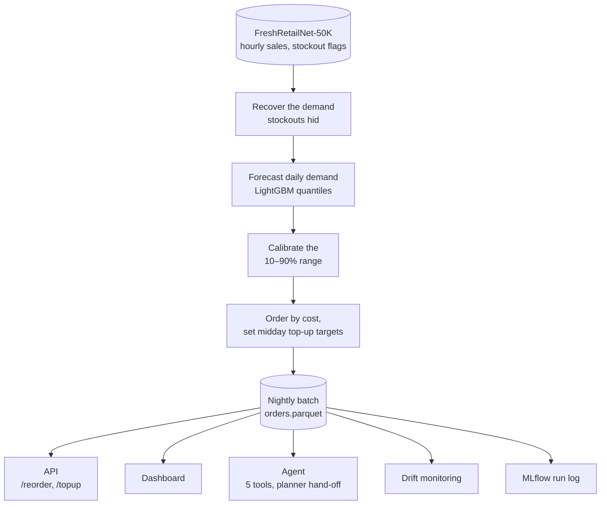

# fresh-replenish

**Ordering fresh food by cost instead of by the most accurate forecast cut simulated waste + lost-sales cost by 56%** on a held-out week: 4,928 store-product lines (538 products) in 90 quick-commerce dark stores, with a lost sale assumed to cost 9× a wasted unit. Most of that comes from ordering more than the forecast: a fixed 1.7× the median, tuned on past weeks, gets within 6.5%. The [one-page summary](docs/summary.md) gives the business view.

| What | Result |
|---|---|
| Demand hidden by stockouts, recovered | +28% on all days, +62% on stockout days |
| Forecast error (WAPE), held-out week | LightGBM 32.5%; Chronos-2 33.3% zero-shot; reorder last week 41.7% |
| Forecast ranges that hold | 80% of demand inside the calibrated 10–90% range (target 80%) |
| Cost of orders, against the most accurate forecast's median | −56% (−55% against reordering last week's demand) |
| Cost of orders, against a fixed 1.7× that median, tuned on past weeks | −6.5% (95% CI 5–8%) |
| A second delivery, ordered at 13:00 | a further −32% on the 90-store sample, −31% on all 50,000 lines (−23% on days with fully observed demand), before the delivery's own cost |
| A second delivery only where it pays | if a delivery cost the average saving: 7.7 net units per store per day for 37 of 90 stores chosen on past weeks, against 2.0 for every store |
| If unsold stock keeps 2–3 days | cost falls by two-thirds or more; ordering by cost keeps an 8–11% edge over a tuned multiple; a second delivery is worth far less |
| Nightly batch / API | 50,000 series in 13.3 min; p95 14.7 ms per store request |
| AI agent (56 questions × 3 runs) | 99% right tools; every final answer passed the number checker and none gave up; every over-limit order went to a human. On 56 new questions, run once: 99% right tools, 23 of 24 to a human |

The project:

1. recovers the demand that stockouts hide;
2. forecasts it with time-series foundation models and LightGBM;
3. turns forecasts into calibrated, cost-based daily orders;
4. explains each order with an AI agent that hands risky ones to a human.

**Status:** all 8 phases are built.
- **Data foundation:** the data is verified; see the [data audit](reports/data_audit.md).
- **Demand drivers:** see [what drives demand](reports/demand_drivers.md).
- **Hidden demand:** see [recovering hidden demand](reports/demand_recovery.md).
- **Forecasting:** see [forecasting daily demand](reports/forecasting.md).
- **Uncertainty and orders:** see [calibrated forecast ranges](reports/calibration.md) and [cost-based orders](reports/orders.md).
- **Second delivery:** see [a second delivery](reports/topup.md).
- **Service:** see [batch and API](reports/service.md) and [monitoring](reports/monitoring.md).
- **Agent:** see the [agent evaluation](reports/agent_gpt-oss-120b.md).
- **Communication:** a Streamlit dashboard (`uv run streamlit run src/fresh_replenish/dashboard/app.py`) and a [demo script](docs/demo.md).

Each choice is explained in [decisions](docs/decisions.md). What didn't work is in [negative results](docs/negative_results.md), what the results can't claim is in [limitations](docs/limitations.md), and the dataset is described in the [data card](docs/data_card.md).

## How it fits together



The research phases compared the options for each step offline (recovery methods, foundation models, ordering policies). The nightly batch runs the ones they chose.

## Run it

You need Python 3.12 and [uv](https://docs.astral.sh/uv/).

```bash
uv sync
uv run python -m fresh_replenish.data.download   # 115 MB, pinned dataset revision
uv run python -m fresh_replenish.data.audit      # writes reports/data_audit.md
uv run python -m fresh_replenish.analysis.drivers  # writes reports/demand_drivers.md (~1.5 min)
uv run python -m fresh_replenish.imputation.recovery  # writes reports/demand_recovery.md (~45 min on a GTX 1650)
uv run python -m fresh_replenish.forecasting.evaluate  # writes reports/forecasting.md (~10 min; ~2.5 GB of model weights the first time)
uv run python -m fresh_replenish.uncertainty.conformal  # writes reports/calibration.md (~4 min)
uv run python -m fresh_replenish.decisions.newsvendor   # writes reports/orders.md (seconds)
uv run python -m fresh_replenish.decisions.topup        # writes reports/topup.md (~3 min)
uv run python -m fresh_replenish.serving.batch          # nightly orders for all 50,000 series (~13 min)
uv run uvicorn --factory fresh_replenish.serving.api:create_app  # GET /reorder?store_id=0, POST /topup
uv run python -m fresh_replenish.serving.latency        # writes reports/service.md
uv run python -m fresh_replenish.monitoring.drift       # writes reports/monitoring.md
uv run streamlit run src/fresh_replenish/dashboard/app.py  # the dashboard on :8501
docker compose up                                       # the API on :8000, dashboard on :8501, MLflow on :5000
FRESH_LLM=ollama:gpt-oss:120b uv run python -m fresh_replenish.agent.evaluate  # OLLAMA_API_KEY in .env (or google_genai:gemini-3.6-flash)
FRESH_LLM=ollama:gpt-oss:120b uv run python -m fresh_replenish.agent.evaluate holdout  # held-out questions: run once
uv run python -m fresh_replenish.agent.chat "Place an order of 6 units of product 4 for store 57 on 2024-07-02."  # you approve hand-offs
uv run pytest                                    # data and model tests run once the data and weights are downloaded
```

## What the audit found

- **Size:** 4.85 M daily rows covering 50,000 store-product series, 898 stores and 18 cities. Train runs 90 days and eval 7 days.
- **Stockouts:** 19.7% of operating hours (6:00–22:00) are stockouts, and 44% of product-days (one product at one store for a day) have at least one.
- **Time of day:** stockouts climb from about 5% at 7 am to 41% by 9 pm. Evening demand is the most hidden, which is the problem this project goes after.

## What drives demand

These are associations, not causes.

- **Price:** a 10% price cut goes with +14.2% sales (price elasticity −1.26).
- **Non-working days:** they lift sales by 31.7%.
- **Promotions:** holding price fixed, they add +1.4%. On in-stock days alone they add +5.8%, a hint that stockouts hide promotion demand.
- **Stability:** all 7 drivers are stable across random halves of the stores.

## Recovering hidden demand

Methods were scored on in-stock hours we hid ourselves, using the dataset paper's protocol, so the true demand is known.

- **Without recovery,** demand on those days is understated by 70.9%.
- **The simple in-stock-hour profile wins,** with WAPE 37.9% and no bias. SAITS (45.5%), Tobit (47.7%) and TimesNet (71.0%) all do worse.
- **Effect:** recovered demand adds 28% to total train demand, and 62% on stockout days.

## Forecasting

Each model forecast recovered demand 7 days ahead from 4 weekly starting points, for 4,928 store-product series.

- **Every model beats seasonal naive in every fold.** Seasonal naive repeats last week; its WAPE is 44.2%.
- **LightGBM is the most accurate,** at WAPE 33.2%.
- **The zero-shot foundation models come within 1–2 points:**
  - Chronos-2 with known inputs: 34.3%;
  - TimesFM-2.5: 34.5%;
  - Toto-2.0: 35.1%.
- **Known inputs** (discount, promotion, holiday) help Chronos-2 by 0.6 points.
- **No leakage:** none of the foundation models' published training data includes this dataset.

## Calibrated ranges and cost-based orders

The checks use a held-out week (Jun 26–Jul 2) that no model saw.

- **Calibrated ranges:** split-conformal calibration per product category brings every model's 10–90% range to 78.7–80.0% coverage (target 80% ± 2), up from 74.9–78.5%.
- **Costs are assumed:** with no prices in the data, a lost sale costs 0.5× to 9× a wasted unit. The headline is 9×, because quick commerce runs availability-first.
- **Cost-based orders win:** at 9×, LightGBM's cost-based orders cost 55% less than reordering last week's demand (recovered, so its stockout gaps are filled in).
- **The most accurate number is a poor order:** ordering LightGBM's median costs 2.3× as much as its cost-based order, and more than reordering last week's demand.
- **Most of the gain is ordering more:** a fixed multiple of the median, chosen on past weeks (1.7×), costs 1.013 per unit of demand. Cost-based orders are 6.5% cheaper than that (95% CI 5–8%), so per-line calibrated ranges add that last part, not the whole 56%.
- **LightGBM is cheapest overall,** at every cost ratio. A foundation model is cheapest in 27 of the 90 stores.

## A second delivery

The orders above commit the whole day before opening. The hourly data shows what a midday top-up would be worth.

- **The plan:** send 80% of the order in the morning, count the shelf at 13:00, and order up to a rest-of-day target for a 15:00 delivery. The 2-hour lead time is assumed. The hour and share were chosen on four past weeks, and the held-out week only scores them.
- **Result at 9×:** cost falls 32%, from 0.947 to 0.646 per unit of demand (paired 95% CI 31–33%). Waste drops by a quarter and the fill rate rises from 95.7% to 97.5%.
- **Every cost ratio gains:** from 20% at 0.5× to 32% at 9×.
- **Timing:** sales peak around 9:00 and 16:00, and the best delivery lands just before the second peak.
- **At full scale:** replaying the served plan on all 50,000 lines in 898 stores saves 31% (0.953 to 0.654 per unit of demand), and 23% on days with no stockout. The plan was chosen on 90 stores, so about 90% of these lines played no part in it.
- **Observed days:** on days with no stockout, where hourly demand is fully observed, the saving is 23%. On other days the afternoon is recovered, not seen. Days with no stockout are also quieter (average demand 1.25 against 1.79), so the gap is not all down to recovery.
- **Not counted:** the delivery's own cost. At 9× the saving is worth 24.3 wasted units per store per day, so a second delivery pays only below that.
- **Where it pays:** the saving is uneven. The top fifth of the 90 stores hold 43% of it, and 27 save less than half the average. If a delivery cost the average past saving (22.4), delivering to every store would net 2.0 per store per day. Delivering only to the 37 stores chosen on past weeks nets 7.7, which is 5.8 more (95% CI 4.4–7.1) and close to the 7.9 that hindsight allows.
- **Store size is enough to choose:** picking as many stores by past demand alone nets 7.6, so no per-store simulation is needed to rank them.

## If stock keeps longer

Everything above throws unsold stock away the same night. The data has no shelf lives, so this check lets unsold units keep for up to 3 days at 9×, oldest sold first.

| Shelf life | Median as is | Tuned multiple of the median | Cost-based orders | With a second delivery | Second delivery's saving | Its worth (wasted units per store per day) |
|---|---|---|---|---|---|---|
| 1 day | 2.166 | 1.013 (1.7×) | 0.947 | 0.646 | 32% | 24.3 |
| 2 days | 2.074 | 0.349 (2.2×) | 0.311 (1.3×) | 0.231 | 25% | 6.4 |
| 3 days | 2.069 | 0.173 (2.7×) | 0.158 (1.5×) | 0.134 | 15% | 2.0 |

Costs are per unit of demand. Multiples are chosen on past weeks for each shelf life.

- **Shelf life matters most:** one extra day cuts the cost of cost-based orders by two-thirds.
- **Ordering by cost keeps a small edge:** 6.5%, 11% and 8.5% over the tuned multiple, with 95% intervals above 0.
- **The second delivery pays mainly for stock that lasts a day:** its worth falls by three-quarters at 2 days and by over 90% at 3 days.
- **Why everything is re-tuned:** stock that keeps makes overstock cheap, so the newsvendor level stops being the best one. A first pass that left some policies untuned showed far bigger gaps; see [negative results](docs/negative_results.md).

## Service

- **Batch job:** each night it trains LightGBM, calibrates the forecasts and writes cost-based orders and rest-of-day targets for all 50,000 series. A run takes 13.3 minutes on this laptop and is tracked in MLflow.
- **API:** `GET /reorder?store_id=…&ratio=…` returns a store's orders, recomputed for any cost ratio from 1/9 to 9. It reads the orders again whenever the nightly batch rewrites them. p95 latency is 14.7 ms.
- **Top-up:** `POST /topup` takes a store's 13:00 shelf count and returns the units to order for each counted line, up to its rest-of-day target. `/reorder` says what share of each order to send in the morning (the plan chosen at 9×, at every ratio). p95 latency is 12.3 ms for a whole store.
- **Monitoring:** it checks median bias, range coverage and stockout drift, overall and per category, and replays the served top-up plan on the week. On the held-out week everything is within limits overall (coverage 81.5%), and 13 of 32 categories raise at least one alert.
- **Docker:** one slim image (no ML stack) runs the API and the dashboard, and `docker compose up` adds MLflow. GitHub Actions runs `docker compose up` on tiny smoke data, then checks `/reorder`, `/topup`, MLflow and that the dashboard opens.

## Agent

A LangGraph agent turns the forecasts into explained orders.

- **Tools:** five plain-code tools: forecast lookup, cost-based order within limits, top-up advice from a shelf count, Chronos-2 what-if, and decision record.
- **Numbers:** a checker rejects an answer with a number that isn't in a tool output or the question; small counts and ranks like "90th" are allowed.
- **Hand-off:** orders over the limits pause for a planner's approval. After a rejection, only an order a planner approved can be saved in that conversation.
- **Stops:** the agent stops after 5 failed tool calls, and hears about the save tool only when the question asks to save.
- **Evaluation:** 56 scripted questions, each run three times, score tool choice, numbers, hand-offs, refusals and latency (and cost, when `FRESH_LLM_PRICE` is set).
- **Results** ([agent evaluation](reports/agent_gpt-oss-120b.md)): on Ollama Cloud `gpt-oss:120b`, re-run with the top-up tool; 167 of 168 runs finished and one hit a provider error (misses are in [negative results](docs/negative_results.md)):
  - correct tool choice 99%;
  - every final answer passed the number checker, 99% on the first try, and none gave up;
  - every over-limit order was handed to a planner, and nothing was saved after a rejection;
  - all 12 top-ups with a shelf count were right, and all 6 without one asked for it;
  - every out-of-scope and missing-data question was handled correctly;
  - p50 latency 3.0 s.
- **Held-out check:** 56 new questions, reworded and drawn again, were run once after all tuning: right tools 99%, every answer passed the number checker with none giving up, and 23 of 24 over-limit orders went to a planner ([report](reports/agent_holdout_gpt-oss-120b.md)). The miss is in the negative results.

## Data

[FreshRetailNet-50K](https://huggingface.co/datasets/Dingdong-Inc/FreshRetailNet-50K) by Dingdong, licensed [CC BY 4.0](https://creativecommons.org/licenses/by/4.0/). See the paper: [arXiv 2505.16319](https://arxiv.org/abs/2505.16319).

## Licence

Code: [MIT](LICENSE). The dataset keeps its own CC BY 4.0 licence.
